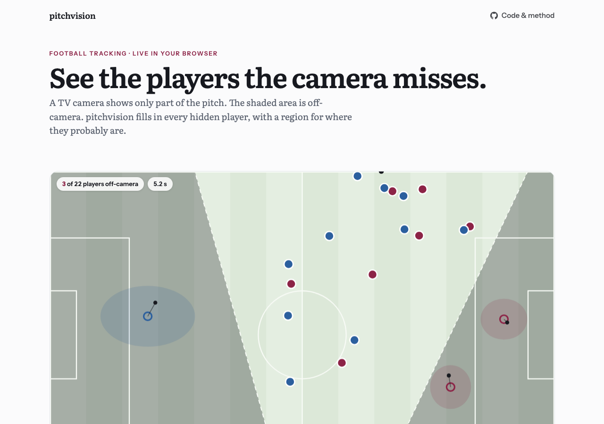
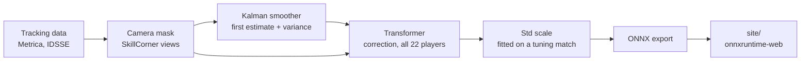

# pitchvision

**See the players the camera misses.** A TV broadcast of a football match shows only part of the pitch, so tracking data
built from broadcast footage has holes: about half of all player positions are off-screen at any moment.
pitchvision fills them in. For every hidden player it gives a position and a 90% region for where they probably are,
and it predicts where all 22 players will be 4 seconds later.

It works on player-tracking data (x, y positions), not on video pixels.

**Live:** <https://shlokkvaishnav.github.io/pitchvision/>: the model runs in your browser on real Bundesliga clips.

[](https://shlokkvaishnav.github.io/pitchvision/)

## How it works
1. **Realistic gaps.** We take full-pitch tracking data (every player, 10 Hz) and hide whoever a real broadcast camera
   would not show. The camera views come from SkillCorner's open broadcast data. Most of the hidden time (74%) is in gaps
   of 9.6 seconds or more, which is what makes the problem hard.
2. **Classical first guess.** A Kalman smoother runs over the whole match and gives each hidden player an estimate and a variance.
3. **Learned correction.** An axial transformer (attention across time and across the 22 players and the ball) corrects that
   estimate using where everyone else is. Its last layer starts at zero, so before training it equals the Kalman estimate
   and it can only learn to improve on it.
4. **Calibrated uncertainty.** One scale factor on the predicted spread, fitted on a separate match, makes the 90% regions honest.
5. **In the browser.** The model is exported to ONNX (4 MB) and runs with onnxruntime-web. No server.



## Results
Final test on 2 Bundesliga matches that were locked in code until the end (IDSSE, 2.9 million hidden player positions).
The model, its settings and the pass/fail rules were committed before the run, and it was run once.

| | pitchvision | Best classical method | Result |
|---|---|---|---|
| Hidden players, median error | **2.70 m** | 3.28 m (cubic spline); Kalman smoother 3.81 m | 18% lower |
| Hidden players, mean error | **4.78 m** | 9.32 m (spline) | Far fewer large misses in long gaps |
| 90% regions contain the truth | **92.4%** | — | Calibrated |
| 4 s forecast, mean error | **5.18 m** | 6.97 m (constant velocity) | 26% lower, on the 66% of positions where constant velocity can guess |

What does not work:
- **Jerky forecasts.** The forecast wobbles frame to frame. A moving average fixes most of it at no cost in accuracy.
- **Red cards.** The model needs 11 v 11. One locked match had a red card, so only 7% of it could be scored, and there
  the model only tied the spline.
- **Small data.** 5 training matches. With 2, the model was worse than the Kalman smoother.
- **The "what if" plays** in the original plan were not built.

**How it was tested, every experiment (including the failures), related work and limitations: [docs/method.md](docs/method.md).**

## Related work
The closest prior work is DeepMind and Liverpool FC's Graph Imputer (Omidshafiei et al., *Scientific Reports*, 2022,
[doi:10.1038/s41598-022-12547-0](https://doi.org/10.1038/s41598-022-12547-0)), which imputes off-screen players with
variational LSTMs and graph networks on 105 matches. pitchvision takes a different route: a classical estimate plus a learned
correction, checked uncertainty, open data only, and a locked test against the strongest classical baseline we could find.
We did not run Graph Imputer, so we make no claim about which is more accurate. More in [docs/method.md](docs/method.md#related-work).

## Engineering
- **Python and the browser agree.** A Node test runs the ONNX model in onnxruntime-web and compares it with PyTorch on the demo clips (max difference < 1e-4).
- **Reproducible.** `make reproduce` downloads the released weights (pinned SHA-256), rebuilds every evaluation result and the demo
  on CPU, and compares them with the committed files. Dependencies are pinned in `requirements.lock`.
- **Locked test set in code.** The loaders refuse the held-out matches unless the final spec asks for them.
- **Fast data loading.** A vectorised path for kloppy loads one IDSSE match in 7 s instead of 121 s.
- **GPU training on Kaggle**, one kernel and one code snapshot per run. Every result is a JSON file with its git commit.
- **Checks on each push:** ruff, mypy, pytest and the Node test. No scheduled CI.

## Quick start
```bash
make install        # Python 3.12, creates .venv with pinned versions
npm ci              # onnxruntime-web, for the browser parity test
make check          # lint, types, tests
make reproduce      # released weights -> all evaluation results + demo, compared with the committed files
```
Training: `PYTHONPATH=src python scripts/train_more.py --out results` (about 1 hour on a Kaggle GPU; see `kaggle/`).

## Layout
| Path | Content |
|---|---|
| `src/pitchvision/` | Data loading, camera masks, baselines (Kalman, spline), model, training loop, metrics |
| `scripts/` | One script per experiment, plus the demo export and the reproduce checks |
| `kaggle/` | Kaggle kernels for the GPU and CPU runs |
| `docs/method.md` | How it was tested, all results, related work, limitations |
| `docs/specs/` | The written plan and result of each experiment |
| `results/` | One JSON file per experiment, with the git commit |
| `site/` | The web page (HTML, CSS, JavaScript, no framework) |

## Data and credits
- IDSSE Bundesliga tracking data: Bassek et al., Scientific Data 12, 195 (2025), CC BY 4.0.
- [Metrica Sports sample data](https://github.com/metrica-sports/sample-data).
- [SkillCorner open data](https://github.com/SkillCorner/opendata): broadcast camera views for the masks.
- [kloppy](https://github.com/PySport/kloppy) for data loading.
- Fonts: Literata and Instrument Sans (SIL Open Font License), in `site/assets/licenses/`.
