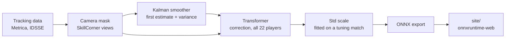

# pitchvision

**See the players the camera misses.** A TV broadcast of a football match shows only part of the pitch, so tracking data
built from broadcast footage has holes: about half of all player positions are off-screen at any moment.
pitchvision fills them in. For every hidden player it gives a position and a 90% region for where they probably are,
and it predicts where all 22 players will be 4 seconds later.

It works on player-tracking data (x, y positions), not on video pixels.

The question behind the project: **broadcast tracking misses about half the players. How much football analysis does
that break, and how much does filling them in bring back?**

**Live:** <https://shlokkvaishnav.github.io/pitchvision/>: the model runs in your browser on real Bundesliga clips.

[](https://shlokkvaishnav.github.io/pitchvision/)

## How it works
1. **Realistic gaps.** We take full-pitch tracking data (every player, 10 Hz) and hide whoever a real broadcast camera
   would not show. The camera views come from SkillCorner's open broadcast data. Most of the hidden time (74%) is in gaps
   of 9.6 seconds or more, which is what makes the problem hard.
2. **Classical first guess.** A Kalman smoother runs over the whole match and gives each hidden player an estimate and a variance.
3. **Learned correction.** An axial transformer (attention across time and across the 22 players and the ball) corrects that
   estimate using where everyone else is. Its last layer starts at zero, so before training it equals the Kalman estimate
   and it can only learn to improve on it.
4. **Calibrated uncertainty.** One scale factor on the predicted spread, fitted on a separate match, makes the 90% regions honest.
5. **In the browser.** The Kalman smoother is ported to plain JavaScript, and the model is exported to ONNX (4 MB) and
   runs with onnxruntime-web. Both run in the page on the demo clips. No server.



## What filling in gives back
Three analyses that need all 22 players, each run three ways on the same moments: with the true positions, with only
the players the camera sees, and with the hidden players filled in. Two Bundesliga matches the released model never
trained on, real broadcast camera views. Exploratory: these were the model's earlier test matches, so this is not a
fresh test ([spec 13](docs/specs/13-downstream.md), `results/13-downstream.json`).

| Analysis | Visible players only | Filled in (Kalman) | Filled in (pitchvision) | Full truth |
|---|---|---|---|---|
| Pitch control: same team controls the cell as with full truth | 72.6% | 91.6% | **93.8%** | 100% |
| Pass receiver: top-1 accuracy | the receiver is off-camera in 33% of passes | 40.5% | 40.0% | 44.8% |
| Ghost team: mean error of the "expected" defence | — | 9.09 m | **8.66 m** | 8.38 m |

- **Pitch control:** filling in gives back 78% of the agreement that hiding players loses (95% interval 72% to 81%),
  against 69% for the Kalman smoother alone.
- **Ghost team:** with the model's positions the ghost defence is within 0.28 m of what it is with full tracking
  (0.22 to 0.35 m), against 0.71 m with Kalman.
- **Passes:** filling in makes the off-camera third of passes answerable and keeps most of the accuracy, but the
  model adds nothing over Kalman here.

The two models used above, trained on full tracking (leave-one-match-out over the development matches, exploratory):
- **Ghost team** ([spec 10](docs/specs/10-ghost-team.md)): a transformer that places one team where it "should" be,
  given the other team and the ball. Error 8.36 m against 11.36 m for a baseline where the team slides with the ball (26% lower; 95% interval of the
  ratio 0.725 to 0.749). Its
  90% regions cover only 59%, so they are not shown as calibrated.
- **Pass receiver** ([spec 11](docs/specs/11-pass-receiver.md)): a transformer over the 22 players and the ball picks
  the receiver first 47.1% of the time, against 36.6% for a conditional logit and 27.4% for the nearest teammate. Its
  log loss is worse than the logit's (2.21 against 1.76): it is overconfident when wrong.

## Imputation results (the foundation)
Final test on 2 Bundesliga matches that were locked in code until the end (IDSSE, 2.9 million hidden player positions).
The model, its settings and the pass/fail rules were committed before the run, and it was run once.
The pooled numbers are mostly one match: J03WOH gives 2.76 million of the 2.93 million scored positions (94%), because a
red card left little of J03WN1 that could be scored (see below).
Intervals: block bootstrap over 5-minute stretches of play. Retraining with 2 other seeds moves the numbers by at most
0.06 m, and all 3 seeds pass ([spec 08](docs/specs/08-seeds-and-intervals.md)).

| | pitchvision | Best classical method | Result |
|---|---|---|---|
| Hidden players, median error | **2.70 m** | 3.28 m (cubic spline); Kalman smoother 3.81 m | 18% lower (95% CI 13 to 22%) |
| Hidden players, mean error | **4.78 m** | 9.32 m (spline) | Far fewer large misses in long gaps |
| 90% regions contain the truth | **92.4%** | — | Calibrated |
| 4 s forecast, mean error | **5.18 m** | 6.97 m (constant velocity) | 1.8 m lower (95% CI 1.6 to 2.0 m), on the 66% of positions where constant velocity can guess |

What does not work:
- **Jerky forecasts.** The forecast wobbles frame to frame. A moving average fixes most of it at no cost in accuracy.
- **Red cards.** The model needs 11 v 11. One locked match had a red card, so only 7% of it could be scored, and there
  the model only tied the spline.
- **Small data.** 5 training matches. With 2, the model was worse than the Kalman smoother.
- **"What if" is a toy.** On the page you can drag any player and the model forecasts how the others move over the
  next 4 s. It only ever saw real play, never a player who jumps 20 m, so the reaction is out of distribution and
  untested. A Node test checks only that it cannot see the real future (`tests/js/react.test.mjs`).

**How it was tested, every experiment (including the failures), related work and limitations: [docs/method.md](docs/method.md).**

## Related work
The closest prior work is DeepMind and Liverpool FC's Graph Imputer (Omidshafiei et al., *Scientific Reports*, 2022,
[doi:10.1038/s41598-022-12547-0](https://doi.org/10.1038/s41598-022-12547-0)), which imputes off-screen players with
variational LSTMs and graph networks on 105 matches. pitchvision takes a different route: a classical estimate plus a learned
correction, checked uncertainty, open data only, and a locked test against the strongest classical baseline we could find.
We did not run Graph Imputer, so we make no claim about which is more accurate. More in [docs/method.md](docs/method.md#related-work).

## Engineering
- **Python and the browser agree.** Two Node tests on the demo clips: the JavaScript Kalman smoother against the Python one
  (max difference < 1e-6 m on means and m² on variances, float64), and the whole page pipeline (JavaScript Kalman, then
  ONNX in onnxruntime-web) against Python Kalman and PyTorch (max difference < 1e-4).
- **Pitch control in the page.** Spearman's pitch-control model, ported from Laurie Shaw's open implementation (MIT),
  runs in plain JavaScript on a 48 × 31 grid in about 2 ms per frame. A Node test checks it against the Python version
  (`src/pitchvision/pitch_control.py`, max difference < 1e-6). With the hidden players filled in, it gives the same team
  control as the true positions on 95% to 99% of the pitch, averaged over every frame of the 3 demo clips (95% in the clip
  where 54% of players are hidden; `scripts/pitch_control_demo.py`, `results/pitch_control_demo.json`). Demo clips only, not a study.
- **Likely pass and defensive shape in the page.** The spec 11 pass model and the spec 10 ghost team run on the
  positions the page draws (seen players plus filled-in ones), precomputed per frame for the demo clips by
  `scripts/export_overlays.py`. Neither model trained on the demo match.
- **Reproducible.** `make reproduce` downloads the released weights (pinned SHA-256), rebuilds every evaluation result and the demo
  on CPU, and compares them with the committed files. Dependencies are pinned in `requirements.lock`.
- **Locked test set in code.** The loaders refuse the held-out matches unless the final spec asks for them.
- **Fast data loading.** A vectorised path for kloppy loads one IDSSE match in 7 s instead of 121 s.
- **GPU training on Kaggle**, one kernel and one code snapshot per run. Every result is a JSON file with its git commit.
- **Checks on each push:** ruff, mypy, pytest and the Node test. No scheduled CI.

## Quick start
```bash
make install        # Python 3.12, creates .venv with pinned versions
npm ci              # onnxruntime-web, for the browser parity tests
make check          # lint, types, tests
make reproduce      # released weights -> all evaluation results + demo, compared with the committed files
```
Training: `PYTHONPATH=src python scripts/train_more.py --out results` (about 1 hour on a Kaggle GPU; see `kaggle/`).

## Layout
| Path | Content |
|---|---|
| `src/pitchvision/` | Data loading, camera masks, baselines (Kalman, spline), model, training loop, metrics |
| `scripts/` | One script per experiment, plus the demo export and the reproduce checks |
| `kaggle/` | Kaggle kernels for the GPU and CPU runs |
| `docs/method.md` | How it was tested, all results, related work, limitations |
| `docs/specs/` | The written plan and result of each experiment |
| `results/` | One JSON file per experiment, with the git commit |
| `site/` | The web page (HTML, CSS, JavaScript, no framework) |

## Data and credits
- IDSSE Bundesliga tracking data: Bassek et al., Scientific Data 12, 195 (2025), CC BY 4.0.
- [Metrica Sports sample data](https://github.com/metrica-sports/sample-data).
- [SkillCorner open data](https://github.com/SkillCorner/opendata): broadcast camera views for the masks.
- [kloppy](https://github.com/PySport/kloppy) for data loading.
- Pitch control: Spearman, "Beyond Expected Goals" (MIT Sloan SAC 2018), as implemented in Laurie Shaw's
  [LaurieOnTracking](https://github.com/Friends-of-Tracking-Data-FoTD/LaurieOnTracking) (MIT); ported, without the goalkeeper and offside terms.
- Fonts: Literata and Instrument Sans (SIL Open Font License), in `site/assets/licenses/`.
