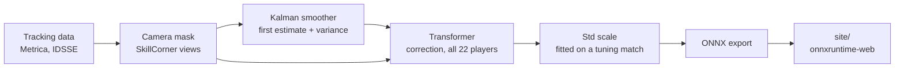

# pitchvision

**See the players the camera misses.** A TV broadcast of a football match shows only a part of the pitch.
pitchvision gives the position of each hidden player, with a 90% region for where the player probably is.
It also predicts where each player will be in the next 4 seconds.

**Live:** <https://shlokkvaishnav.github.io/pitchvision/> — the model runs in your browser.

[](https://shlokkvaishnav.github.io/pitchvision/)

## What it does
- **Imputation.** For each hidden player, the model gives a position and an uncertainty (a 2-D Gaussian).
- **Forecast.** The same model predicts the positions of all 22 players 4 seconds ahead.
- **Real camera masks.** The hidden players come from real broadcast camera views (SkillCorner), not from random masks.
  In our data, about half of the player positions are off-camera, and 74% of the hidden time is in gaps of 9.6 s or more.
- **A web page with no server.** The model is exported to ONNX. The page runs it with onnxruntime-web on real match clips.

## How the model works
A Kalman smoother gives a first estimate from the motion of each player before and after the gap.
A transformer looks at all 22 players and the ball together, and it learns a correction to that estimate.
The last layer starts at zero, thus before training the model is equal to the Kalman estimate.



## What works and what does not
Test: 2 Bundesliga matches that no model saw (IDSSE, 4.6 million hidden player positions).

| Part | Result |
|---|---|
| Imputation | **Works.** Median error 2.43 m. Cubic spline 2.82 m, Kalman smoother 3.27 m. Mean error 4.58 m, against 11.24 m for the spline. |
| Uncertainty | **Works.** The 90% regions contain the true position for 92.1% of hidden positions. |
| Forecast at 4 s | **Works.** Mean error 5.17 m. Constant velocity 6.94 m. |
| With 2 training matches | **Did not work.** The model was worse than the Kalman smoother. With 5 matches, it is better. |
| "What if" plays | **Not built.** |

Each experiment has a written plan with pass/fail rules before the run, in [`specs/`](specs/).
Failed tests and corrections stay in the repository. The holdout matches are locked: the code refuses to load them.

## Engineering
- **The browser and Python agree.** A Node test runs the ONNX model in onnxruntime-web and compares it with PyTorch on the demo clips (difference < 1e-4).
- **Fast data loading.** A vectorised path for kloppy loads one IDSSE match in 7 s instead of 121 s.
- **GPU training on Kaggle.** Each run has its own kernel and its own source dataset. Results are JSON files with the git commit.
- **Checks on each push:** ruff (lint), mypy (types), pytest, Node tests. CI runs only on push, never on a schedule.
- **No raw data in the repository.** The site uses 3 short clips of open IDSSE data (CC BY 4.0), with attribution.

## Quick start
```bash
make install        # Python 3.10+, creates .venv
npm ci              # onnxruntime-web, for the browser parity test
make check          # lint, types, tests
```
Train: `PYTHONPATH=src python scripts/train_more.py --out results` (a GPU is recommended; about 1 hour on a Kaggle GPU).

## Layout
| Path | Content |
|---|---|
| `src/pitchvision/` | Data loaders, camera masks, baselines (Kalman, spline), windows, model, calibration |
| `scripts/` | One script per experiment, plus the demo export |
| `kaggle/` | Kaggle kernels for GPU and CPU runs |
| `specs/` | The plan and the result of each experiment |
| `results/` | The result of each experiment (JSON, with the git commit) |
| `site/` | The web page (HTML, CSS, JavaScript, no framework) |

## Data and credits
- IDSSE Bundesliga tracking data: Bassek et al., Scientific Data 12, 195 (2025), CC BY 4.0.
- [Metrica Sports sample data](https://github.com/metrica-sports/sample-data).
- [SkillCorner open data](https://github.com/SkillCorner/opendata): broadcast camera views for the masks.
- [kloppy](https://github.com/PySport/kloppy) for data loading.
- Fonts: Literata and Instrument Sans (SIL Open Font License), in `site/assets/licenses/`.
